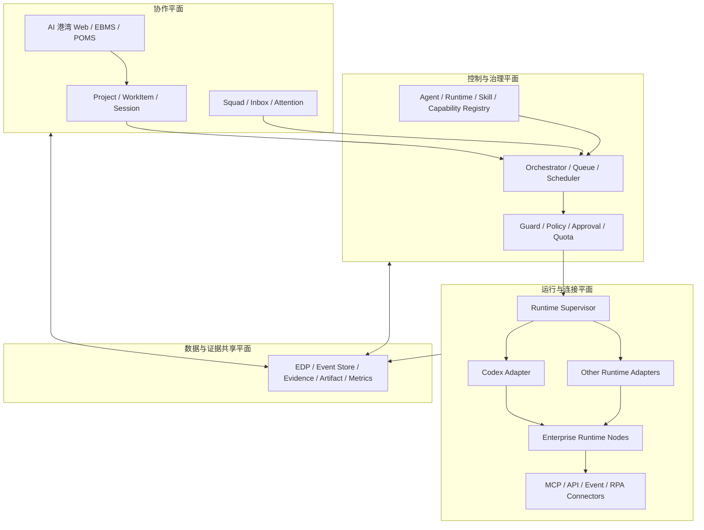

# AEOS AI 港湾架构基线

> 版本：V0.1  
> 状态：目标架构与 MVP 实施基线  
> 日期：2026-09-03  
> 适用范围：`hub` 试点及后续 AEOS AI 资源协作平台

## 1. 文档目的

AI 港湾是 AEOS 统一登记、连接、调度和治理企业 AI 资源的协作平台。它不是单一聊天页面，也不是某个模型或 Agent SDK 的外壳。其目标是让人、持久化智能体、运行节点、业务能力和项目任务在同一套责任、权限、证据和状态模型中协作。

本架构吸收 Multica 的公开产品概念和控制面/执行面分离思想，但采用 clean-room 方式独立设计。AEOS 不复制 Multica 的源码、数据库结构、API、组件或界面。AI 港湾的登录、首页和内部视觉应复用项目指定的“中泰瑞泽经营管理系统”设计资产与交互规范，不以 Multica UI 为视觉来源。

本期必须形成以下共识：

1. Agent 是可治理的持久身份与版本化配置，不是一个常驻进程。
2. Runtime 是执行资源，Codex 只是首个 Runtime Adapter，不是平台领域模型。
3. Session、Run、Attempt 与供应商内部 Thread/Turn/Item 必须解耦。
4. MCP 用于连接 Capability/Tool，不承担全部 agent-to-agent 协作语义。
5. AI 的任何执行结果都必须回到 AEOS 的 Owner、Policy、Approval、Result 和 Evidence 体系。
6. 开发任务执行成功不等于业务结果 `VERIFIED`。

## 2. Clean-room 原则

### 2.1 可借鉴范围

- 人与智能体共用项目、任务、评论、通知和评审入口的产品思想。
- Agent 身份与 Runtime 执行环境解耦。
- 中央控制面维护协作状态，企业执行节点保留代码、凭据和命令权限。
- 任务队列、节点领取、心跳、租约、重试、流式事件和人工评审的通用模式。
- Agent、Skill、Squad、Trigger、Runtime、Run 等公开领域概念。

### 2.2 禁止事项

- 不复制或改写 Multica 源码、迁移脚本、接口定义、数据库表和前端组件。
- 不复刻 Multica 页面布局、品牌、图标组合、交互细节或文案。
- 不引入 Multica 仓库代码作为依赖、子模块、镜像或构建产物。
- 不把对公开实现的阅读结果直接翻译成 AEOS 代码。
- 未经专项许可审查，不使用任何带 Multica License 的代码片段或衍生界面。

### 2.3 工程留痕

- ADR 记录每项关键架构决策及其 AEOS 业务依据。
- 新接口、数据模型和状态机以 AEOS 需求书、产品宪法和验收标准为来源。
- 依赖清单记录许可证、版本、用途和替代方案。
- 合并门禁进行代码来源、许可证和品牌残留检查。

## 3. 系统定位与边界

AI 港湾属于 AEOS 的共享协作与资源治理能力，连接但不取代下列系统：

- **AEOS Kernel**：提供统一身份、组织、对象 ID、策略、审批、事件和治理基础。
- **AgentOS Software Factory**：负责 Agent、Skill、Prompt、Workflow、Adapter 的开发、测试和发布。
- **AEOS Runtime**：承载已发布 Agent 的受控执行。
- **Guard**：执行 Policy、风险分级、授权、审批、配额和禁止规则。
- **Enterprise Data & Evidence Platform**：保存业务事实、事件、Result、Evidence、审计和可追溯关系。
- **EBMS / POMS / 专业自治中心**：提出工作、参与协作、消费结果，并承担业务责任。
- **Integration Gateway**：统一连接 ERP、MES、PLM、CRM、数据平台、消息渠道及其他外部系统。

AI 港湾负责“资源可见、工作可分配、运行可治理、过程可观察、结果可评审”，不负责把所有专业系统重写为一个超级应用。

## 4. 三个主平面 + 一个共享平面

### 4.1 协作平面 Collaboration Plane

面向人和 Agent 的统一工作空间，承载 Enterprise、Project、WorkItem、Session、Comment、Squad、Inbox 和 Attention。它回答：谁与谁协作、正在处理什么、当前需要谁关注。

### 4.2 控制与治理平面 Control & Governance Plane

承载 Agent Registry、Runtime Registry、Capability Registry、Skill Registry、Task Queue、Orchestrator、Scheduler、Policy、Approval、Quota、Cost 和 Audit。它回答：允许谁以哪个版本、在什么边界内、使用哪些资源执行哪项工作。

### 4.3 运行与连接平面 Runtime & Connector Plane

由 Runtime Supervisor、Runtime Adapter、执行节点和 Connector 组成。节点通过主动出站连接领取任务，在企业内网、VPC、专用主机、容器或 VM 内完成实际执行。首个适配器是 Codex Adapter，后续可增加 LLM API、Workflow、Data Job、RPA 和专业系统 Adapter。

### 4.4 数据与证据共享平面 Data & Evidence Plane

为前三个平面提供统一 Object ID、Event、Result、Evidence、Memory、Artifact、Metric、Lineage 和 Search。它回答：输入是什么、发生过什么、谁批准、产生了什么结果、证据是否足以通过门禁。



## 5. 核心领域模型

| 对象 | 作用 | 关键约束 |
| --- | --- | --- |
| `Enterprise` | 企业/租户隔离边界 | 数据、Memory、密钥、运行节点和策略默认严格隔离 |
| `Workspace` | 企业内协作空间 | 可按组织、事业部或试点范围划分，不替代 Enterprise |
| `Project` | 经营项目、自治改造项目或研发项目 | 关联 Objective、Accountable Owner、业务对象和 Progress Registry |
| `WorkItem` | 人与 Agent 共用的工作单 | 对应 AEOS Action；必须有 Owner、风险、验收标准、门禁和 Evidence 要求 |
| `AgentDefinition` | Agent 的稳定身份 | 不含某次运行状态，不等于 Codex Thread 或子 Agent |
| `AgentVersion` | 不可变的发布版本 | 固化 instructions、model policy、Skill、工具权限、评测和风险边界 |
| `RuntimeNode` | 可执行任务的节点 | 记录企业、区域、网络区、容量、在线状态和隔离等级 |
| `RuntimeInstance` | 节点上的运行实例 | 绑定 Adapter、凭据引用、并发、健康状态和租约，不保存业务身份 |
| `RuntimeBinding` | AgentVersion 到 Runtime 条件的映射 | 支持一 Agent 多节点、多 Adapter 和按策略选择 |
| `Session` | 连续协作上下文 | AEOS 自有 ID；供应商 thread ID 仅作为 runtime-specific 引用 |
| `Run` | 一次业务执行请求 | 关联 WorkItem、AgentVersion、PolicyVersion 和预期输出 |
| `Attempt` | Run 的一次实际尝试 | 支持 lease、heartbeat、retry、reclaim、timeout 和幂等 |
| `RunEvent` | 执行过程中的规范化事件 | 供应商 item/notification 必须先归一化，不直接作为 Evidence 契约 |
| `SkillVersion` | 可复用、可评测的能力资产 | 关联 L0-L5、Owner、适用域、输入输出、风险和评测集 |
| `Capability` | 业务系统对外提供的受治理能力 | 由 Capability Registry 寻址，含 SLA、授权角色和契约版本 |
| `Connector` | MCP/API/Event/RPA 等连接配置 | 只保存 Secret 引用，不在业务库保存明文凭据 |
| `Squad` | 人与 Agent 的协作编队 | Leader 负责路由；成员不默认同时执行；Accountable Owner 不被 AI 替代 |
| `Trigger` | 定时或事件触发规则 | 必须绑定 Policy、配额、幂等键、停用开关和审批边界 |
| `Approval` | 风险动作的人审记录 | 包含 actor、role、scope、decision、reason、policyVersion 和 evidenceRefs |
| `EvidenceRef` | 可验证证据引用 | 指向不可篡改或带哈希的证据对象，不把大段原始日志塞入业务对象 |

### 5.1 身份不变量

- `AgentDefinition` 是“谁”，`AgentVersion` 是“以什么配置工作”。
- `RuntimeInstance` 是“在哪里、用什么引擎执行”。
- `Session` 是“持续上下文”，`Run` 是“一次目标明确的工作”。
- `Attempt` 是 Run 的可重试执行，失败重试不得生成新的业务工作单。
- Codex 内建 subagent 是某个 Attempt 内的临时执行单元，不自动注册为港湾 Agent。

### 5.2 建议状态机

`WorkItem`：

```text
DRAFT -> READY -> IN_PROGRESS -> WAITING_HUMAN -> REVIEW -> VERIFIED -> CLOSED
                         |              |             |
                         +-> BLOCKED    +-> REJECTED  +-> REOPENED
```

`Run`：

```text
QUEUED -> DISPATCHED -> RUNNING -> WAITING_APPROVAL -> SUCCEEDED
   |          |            |              |              |
   +-> CANCELLED            +-> FAILED     +-> DENIED     +-> PARTIAL
```

只有满足 WorkItem 的业务验收标准、Evidence 门禁和 Accountable Owner 责任要求，Run 的 `SUCCEEDED` 才能推动 WorkItem 进入 `VERIFIED`。

## 6. Codex 作为 Runtime Adapter

当前 `hub` 将 Conversation 近似等同于 Codex Thread，并由单个 `server.ts` 进程、固定 `CODEX_HOME` 和固定 `cwd` 驱动一个 Codex app-server。该结构适合 A1/A2 只读试点，不可直接扩展为多企业、多 Agent 资源池。

目标架构中，Codex app-server 被封装在 `CodexRuntimeAdapter` 后面：

| Codex 概念 | AEOS 映射 | 说明 |
| --- | --- | --- |
| Thread | `Session.runtimeRef` | 仅是 Codex Adapter 的上下文引用，不作为 AEOS Session 主键 |
| Turn | `Run` 或 `Attempt` 的执行片段 | 是否复用 Session 由策略决定 |
| Item / Notification | `RunEvent` | 归一化后再进入事件与证据管道 |
| MCP Tool | `Capability` 的一种连接方式 | 权限由 AEOS Guard 和 Capability 契约决定 |
| Approval request | `ApprovalRequest` 输入 | 最终审批由 AEOS Approval/Policy 服务记录与裁决 |
| Built-in subagent | Attempt 内临时子执行 | 不等同于 Registry 中持久 Agent，不继承独立业务授权 |

### 6.1 Runtime Adapter 最小契约

```ts
interface RuntimeAdapter {
  readonly kind: string;
  probe(instance: RuntimeInstance): Promise<RuntimeHealth>;
  start(input: StartAttemptInput): Promise<RuntimeExecutionRef>;
  resume(input: ResumeAttemptInput): Promise<RuntimeExecutionRef>;
  cancel(ref: RuntimeExecutionRef): Promise<void>;
  events(ref: RuntimeExecutionRef): AsyncIterable<NormalizedRunEvent>;
  respondToApproval(input: RuntimeApprovalResponse): Promise<void>;
  collectArtifacts(ref: RuntimeExecutionRef): Promise<ArtifactRef[]>;
}
```

平台业务服务只能依赖该契约，不得直接依赖 Thread/Turn/Item、Codex 配置文件格式或供应商生成类型。

### 6.2 Codex 实例隔离

每个 Runtime Instance 至少拥有独立的：

- `CODEX_HOME`、运行账户、工作目录和进程生命周期。
- Enterprise/Workspace/Project 作用域。
- 模型提供商与 Secret 引用。
- MCP/Connector 白名单及网络访问策略。
- 并发上限、成本配额、超时、日志和健康检查。

`hub-config.ts` 不再作为业务主数据来源。AgentVersion、RuntimeBinding 和 Connector 由结构化 Registry 管理，再为单个 Runtime Instance 生成隔离、可追溯、可回滚的运行配置。运行中修改模型不得偷偷改变既有 AgentVersion；配置变化应发布新版本，并按策略新建、迁移或 fork Session。

## 7. 连接、数据与执行边界

### 7.1 中央平台保存

- Agent、Skill、Capability、Connector 和 Runtime 的元数据及版本。
- Project、WorkItem、Session、Run、Attempt、队列、租约和状态。
- Policy、Approval、Quota、成本汇总、审计和脱敏后的运行事件。
- Result、EvidenceRef、ArtifactRef、Metric 和数据血缘。

### 7.2 执行节点保留

- 企业代码、工作副本、构建缓存和本地 CLI 状态。
- 模型、代码仓库及业务系统的实际凭据。
- 受控命令执行、原始输出和需要本地留存的大型 Artifact。
- 由企业安全域限制的网络连接和系统访问权限。

中央平台只保存 Secret 引用、必要的脱敏结果和证据索引，不收集超出业务与审计所需的原始敏感内容。

### 7.3 推荐连接方式

- Runtime Node 主动向中枢建立出站连接，避免中枢直接打入企业内网。
- 节点身份使用 mTLS 或等价设备身份；人、Agent、节点、服务账户分别建模。
- 调度采用 queue + claim + lease + heartbeat + reclaim，所有操作携带幂等键。
- 每次 Attempt 签发短期、最小范围、可撤销的凭据，不下发平台级长期密钥。
- 高风险工具调用先进入 AEOS Guard，再由 Approval 服务形成可审计裁决。
- Connector 执行遵守超时、重试、熔断、Dead Letter 和 Degraded Mode 契约。

### 7.4 设备与现实执行

AI 港湾可以调度连接设备或现场系统的受治理 Capability，但禁止形成 `LLM -> Machine` 直接控制链。安全 PLC、急停、机械联锁、质量和合规门禁必须保留在设备/控制器及专业责任体系中。

## 8. 事件、证据与审计契约

当前 `evidence.jsonl` 可作为试点调试记录，不能直接成为长期 Evidence 数据模型。规范化事件至少包含：

```text
eventId, eventType, occurredAt,
enterpriseId, workspaceId, projectId, workItemId,
sessionId, runId, attemptId,
agentId, agentVersionId,
runtimeNodeId, runtimeInstanceId, runtimeKind, runtimeExecutionRef,
correlationId, causationId, idempotencyKey,
actorType, actorId, policyVersionId,
riskLevel, approvalId,
resultRefs, evidenceRefs, artifactRefs,
payloadSchemaVersion, payloadRedaction, payloadHash
```

证据链遵守以下规则：

1. 原始 Runtime 事件先归一化，再进入 Outbox/Event Bus/EDP。
2. Approval 必须记录真实 actor、角色、范围、理由和当时生效的 PolicyVersion。
3. 需要长期证明的输出使用不可变 Artifact 或内容哈希，不依赖易失日志位置。
4. Memory 与 Evidence 分离：Memory 可更新、衰减和失效；Evidence 保留历史事实。
5. 任何跨企业聚合必须经过授权、匿名化和商业秘密检查。

## 9. Guard 与权限模型

沿用 AEOS 权限等级：

| 等级 | 含义 | AI 港湾行为 |
| --- | --- | --- |
| `READ_ONLY` | 只读查询 | 可按已授权 Capability 自动执行并完整留痕 |
| `AUTO_INTERNAL` | 企业内部可逆动作 | 在金额、范围、置信度和配额阈值内自动执行 |
| `APPROVAL_REQUIRED` | 需人审批 | 冻结 Attempt，生成 Approval，批准后继续 |
| `HUMAN_ONLY` | 仅人可执行 | Agent 只能准备材料、建议动作和证据 |
| `PROHIBITED_FOR_AI` | AI 禁止 | Guard 直接拒绝，不允许人工按钮绕过产品宪法 |

审批对象不能只有 `reqId + accept/decline`。最小字段必须包括 Enterprise、WorkItem、Run、Attempt、AgentVersion、动作摘要、参数脱敏视图、风险、影响范围、PolicyVersion、审批人、决定、理由、时间和 EvidenceRef。

Runtime 子进程通常继承其 OS 用户权限，短期 Token 和独立 workdir 不能替代真正的安全隔离。生产节点必须采用专用 OS 用户、容器或 VM、最小权限 Secret、网络白名单和审计策略。

## 10. AI 港湾产品模块

### 10.1 MVP 导航

- **港湾总览**：在线 Agent/节点、任务队列、运行中、阻塞、待审批、失败、成本和容量。
- **智能体目录**：Agent 身份、版本、Owner、状态、专业域、风险和可用范围。
- **智能体详情**：Instructions、Model Policy、Runtime Binding、Skill、Capability、权限、版本、评测和活动。
- **运行节点**：节点在线状态、区域、安全域、Adapter、并发、负载、健康和最近错误。
- **任务运行中心**：WorkItem、Run、Attempt、事件时间线、Artifact、Evidence、重试和取消。
- **Skill / Capability 库**：版本、成熟度、Owner、输入输出、SLA、风险和评测结果。
- **协作编队**：Leader、成员、职责、路由规则、升级路径和 Accountable Owner。
- **触发器**：定时、Webhook、业务事件、幂等、配额和停用开关。
- **连接器**：MCP/API/Event/RPA 配置、Secret 引用、作用域、健康和权限。
- **审批与审计**：待办、历史、策略命中、风险、证据和追责链。
- **对话与收件箱**：Session、评论、Mentions、阻塞、评审和 Attention 排序。

界面只展示与当前角色有关的信息。管理者日常入口以目标、异常、决策、行动和证据为主，不退化成传统配置菜单集合。

## 11. MVP 与演进路线

### 阶段 M0：封装现有试点

目标：在不破坏当前演示链路的前提下建立正确边界。

- 定义 `RuntimeAdapter`，用 `CodexRuntimeAdapter` 包装现有 `codex-client.ts`。
- 增加 `RuntimeSupervisor`，负责进程、健康、启动、停止和隔离目录。
- 将 AEOS Session/Run ID 与 Codex Thread/Turn ID 分离。
- 建立 AgentVersion、RuntimeInstance、Session、Run、Attempt、Approval 的 SQLite Repository。
- 将 JSONL 事件映射为规范化 `RunEvent`；旧 WebSocket 仅保留为兼容入口。
- 保持 A1/A2 只读 Guard，禁止因架构改造扩大执行权限。

### 阶段 M1：形成可用 AI 港湾

目标：支持单企业内多个可治理 Agent 和 Codex Runtime Instance。

- 上线 Agent/Runtime/Skill/Capability Registry。
- 上线队列、claim、lease、heartbeat、retry、cancel 和幂等。
- 上线结构化 Policy/Approval 服务，替换前端审批透传。
- 完成总览、智能体、节点、运行、连接器、审批六个核心页面。
- 支持项目、WorkItem、评论、Evidence 门禁及 Progress Registry 回写。

### 阶段 M2：多 Runtime 与人机编队

目标：从“Codex 控制台”演进为通用 AI 资源协调平台。

- 增加 LLM API、Workflow、Data Job、RPA 和专业 Capability Adapter。
- 支持 Squad Leader 路由、成员选择、任务拆分、升级和人工接管。
- 支持 Trigger/Autopilot、配额、成本中心、失败恢复和 Dead Letter。
- Runtime Node 使用设备身份与主动出站连接，完善企业/网络域隔离。
- Evidence 通过 Outbox 接入 EDP，运行指标接入统一可观测平台。

### 阶段 M3：A3 治理与规模化

目标：在明确边界内实现可度量、可回退的受控自治。

- 动态决策边界综合金额、风险、不确定性、影响范围、可逆性、时效、Evidence Confidence 和授权范围。
- Agent/Skill/Model 建立离线评测、线上 Champion/Challenger 和回滚。
- Attention Engine 降低无效提醒，优先呈现需人决定的例外。
- 建立 SLO、Error Budget、容量治理、灾备、多租户和商业秘密审计。
- 业务结果通过 Result -> Evidence -> Owner Gate 验证，不以运行数量作为成功指标。

## 12. MVP 验收不变量

满足以下条件才可认为 AI 港湾基础架构成立：

1. 同一个 AgentVersion 可在不同 Runtime Instance 上执行，业务层无需知道 Codex Thread 细节。
2. Runtime 进程重启或更换供应商，不会丢失 AEOS WorkItem、Run、Approval 和 Evidence 关系。
3. 每个高风险动作都能回答“谁请求、哪个版本、为何允许、谁批准、执行了什么、证据在哪里”。
4. 一个企业的 Agent、节点、Secret、Memory 和 Artifact 不可被另一企业访问。
5. Run 成功不会绕过业务验收和 Accountable Owner 门禁。
6. Agent 配置变更通过不可变 AgentVersion 发布，历史运行可以准确复现其配置来源。
7. Codex 不可用时，平台仍能查看资源、工作、审批、历史证据，并可接入其他 Adapter。
8. MCP 服务失效只影响对应 Connector/Capability，不拖垮整个控制面。

## 13. Multica 许可证警示

截至 2026-09-03，Multica 仓库使用的不是纯 Apache-2.0，而是由 Part I 附加条件与 Part II Apache License 2.0 共同组成的 **Multica License**。其公开许可证包含以下重要限制：

- 单一组织内部使用可以不取得商业许可。
- 未获商业许可，不得基于 Multica 源码向第三方提供托管服务，也不得将其嵌入对外销售、许可或商业分发的产品/服务。
- 派生自其 UI 代码的界面，未获书面 branding waiver 不得移除或修改 Multica 名称、Logo、版权和署名信息。
- 即使只使用 backend、daemon 或 CLI，也存在保留通知和在用户文档声明构建于 Multica 的要求。

AEOS 具有后续对外复制和商业化目标，因此本项目默认执行以下规则：

1. 仅参考公开思想和通用架构模式，clean-room 自研全部代码和界面。
2. 不把 Multica 作为 AEOS 后端、前端、daemon、CLI 或 SDK 依赖。
3. 任何复用提议必须先经过法务和开源许可证专项审查。
4. 本文是工程风险提示，不构成法律意见；正式商业决策以法律审查结论为准。

参考来源：

- Multica 官方仓库：<https://github.com/multica-ai/multica>
- Multica 架构说明：<https://multica.ai/docs/developers/architecture>
- Multica 核心概念：<https://multica.ai/docs/concepts>
- Multica 工作原理：<https://multica.ai/docs/how-multica-works>
- Multica 安全模型：<https://multica.ai/docs/security-model>
- Multica License：<https://github.com/multica-ai/multica/blob/main/LICENSE>

## 14. 架构决策摘要

| 决策 | 结论 |
| --- | --- |
| 平台结构 | 三个主平面 + 一个数据与证据共享平面 |
| 首个 Runtime | Codex app-server，经 `CodexRuntimeAdapter` 接入 |
| 协作主键 | AEOS 自有 Enterprise/Project/WorkItem/Session/Run ID |
| Codex Thread | 仅作为 Adapter 内部 `runtimeRef` |
| Agent 配置 | `AgentDefinition + immutable AgentVersion` |
| 工具连接 | MCP 是 Connector 类型之一，统一映射到 Capability |
| 执行方式 | 企业节点主动出站连接、领取任务、短期授权、流式回传 |
| 审批归属 | AEOS Guard + Approval/Policy 服务，Runtime 只做协议适配 |
| 证据归属 | EDP 为长期事实源，JSONL 仅作试点与调试 |
| 代码策略 | clean-room 自研，不复用 Multica 源码或 UI |

