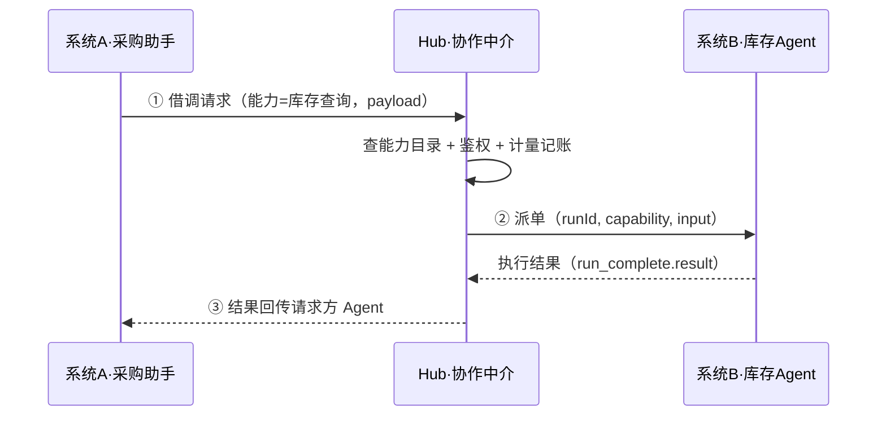
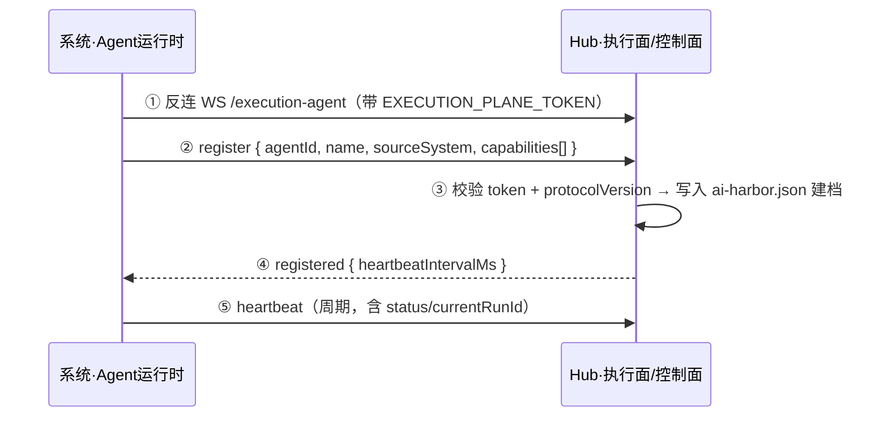
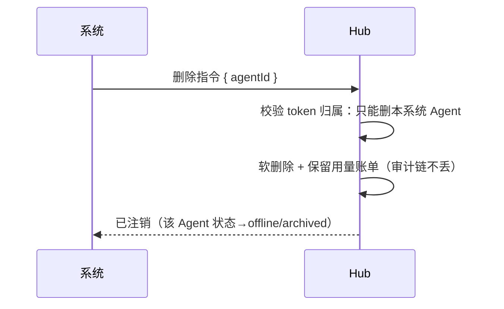
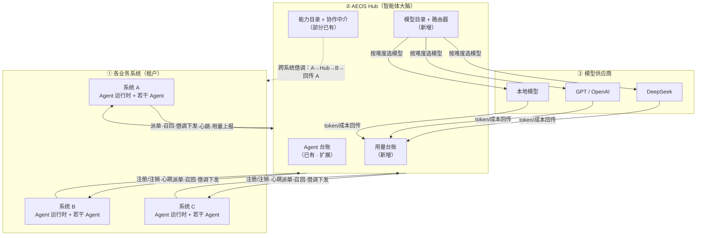

# AEOS Hub 重新定位设计（智能体大脑 / 虚拟人事系统）

> 状态：设计稿（未实施）。对应架构图：`docs/hub-brain-architecture.svg`。
> 结论先行：当前 `data/ai-harbor.json`（AI 港湾）+ `execution-plane.ts`（执行面）已经是新定位的 60% 底座，
> 新定位 = **加三块、改两处**，不是重写。

## 1. 一句话定位

Hub 不做业务数据，只做四件事：

**认人（台账）→ 选模型（路由）→ 算钱（计量）→ 借调（协作）**

- 认人：知道每个 Agent 是谁（模型、成本、Token、能力、状态）。
- 选模型：按任务难度/成本/时延在 deepseek、GPT、本地模型间选型。
- 算钱：记录每次调用的 Token 与成本，按 Agent/系统聚合账单。
- 借调：系统 A 的 Agent 通过 Hub 让系统 B 的 Agent 干活，结果回传 A。

## 2. 现有底座（已具备，别推翻）

| 新定位能力 | 已存在的代码/数据 | 缺口 |
|---|---|---|
| Agent 台账 | `data/ai-harbor.json` + `harbor-store.ts`：层级 L0–L3、生命周期、autonomy、taskServiceProfile、status | `model` 只是字符串，无计价/可路由；无用量字段 |
| 系统 Agent 反连 | `execution-plane.ts`：WS 反向连接、register/heartbeat、能力自描述、dispatch/recall | 只能派单给 Agent，不能「Agent 之间借调」 |
| 能力目录 | `execution-capabilities.ts` + `register.capabilities`（自描述 schema/intent/constraints） | 只有中台一个系统，无跨系统查询入口 |
| 身份/鉴权 | M01（Keycloak）+ `x-aeos-execution-token` | 无「系统自助增删本系统 Agent」的控制面 API |

## 3. 新增三块

### 3.1 模型目录 + 路由器（新增）

- `model_profile`：`provider(deepseek|openai|local)`、`model_name`、`input_price`、`output_price`、`latency_ms`、`context_window`、`tier(轻/中/重)`。
- 路由输入：任务难度（复杂度/预算上限/时延要求/上下文长度/数据脱敏要求）。
- 路由输出：选定 `model_profile`。规则矩阵（可解释）+ LLM 判难度 + 成本上限约束，三者取交集。
- Agent 有「默认模型档」，Hub 按任务动态升降级（普通任务降 deepseek，高风险推理升 GPT）。

### 3.2 用量台账（新增）

- `usage_event`：`agent_id`、`system_id`、`model_id`、`run_id`、`tokens_in`、`tokens_out`、`cost`、`started_at`、`ended_at`。
- 每次 `run_complete` 落一条；聚合出「每个 Agent 花多少钱 / 耗多少 Token」。
- 关联现有 `HarborRun`（run 是任务轨迹，usage_event 是计价，两者通过 `run_id` 关联）。

### 3.3 跨系统协作中介（部分已有，补「借调」）

- 能力目录：各系统上报能力（自描述，复用执行面协议）→ Hub 维护「能力 → 系统/Agent」索引。
- `collab_request`（借调单）：`from_agent`、`from_system`、`capability`、`to_system`、`to_agent`、`payload`、`status(pending/dispatched/running/done/failed)`、`result`、`timestamps`。
- 流程：A 系统 Agent 提需求 → Hub 查目录找到 B 系统能力 → 鉴权 → 派单给 B → B 执行 → 结果回传 A 的请求方 Agent。

## 4. 改两处

1. `HarborAgent.model`：从 `string` → `modelProfileId`（外键到 `model_profile`），保留展示名。
2. Agent 增删：开放控制面 API，让系统**自助增删本系统 Agent**（token 鉴权 + 只能动自己系统的 Agent + 审计）；删除为软删除（保留历史用量，参照现有 `deleteAgent` 的「有运行记录不可删」约束，改为「软删除 + 用量留存」）。

**添加智能体（register 握手，复用执行面协议）**：

**删除智能体（自助注销）**：

## 5. 三个必须拍板的设计决策

| 决策 | 选项 | 推荐 |
|---|---|---|
| Hub 做不做模型网关 | 甲：统一代理，所有模型调用经 Hub（计量零误差、路由真生效）；乙：系统直连模型、事后上报（链路短、计量靠自觉） | **甲为主，边缘系统乙** |
| 跨系统借调同步/异步 | 同步短任务；异步长任务 | **统一「借调单」异步模型**，短任务也包装成单（便于计量+审计） |
| 能力发现目录 vs 点对点 | Hub 维护能力目录 vs 系统之间直连 | **Hub 中介**，不做点对点（否则 Hub 失去大脑地位、无法计量） |

## 6. 建议落地顺序

1. **P0 模型目录 + 路由**：先把 `model` 变成可路由、可计价。
2. **P1 用量台账**：`run_complete` 时落 `usage_event`，看板能看每个 Agent 的成本/Token。
3. **P2 系统自助增删 API**：控制面 + 鉴权 + 审计。
4. **P3 跨系统借调**：能力目录查询 + 借调单 + 结果回传。

## 7. 数据流（Mermaid）

